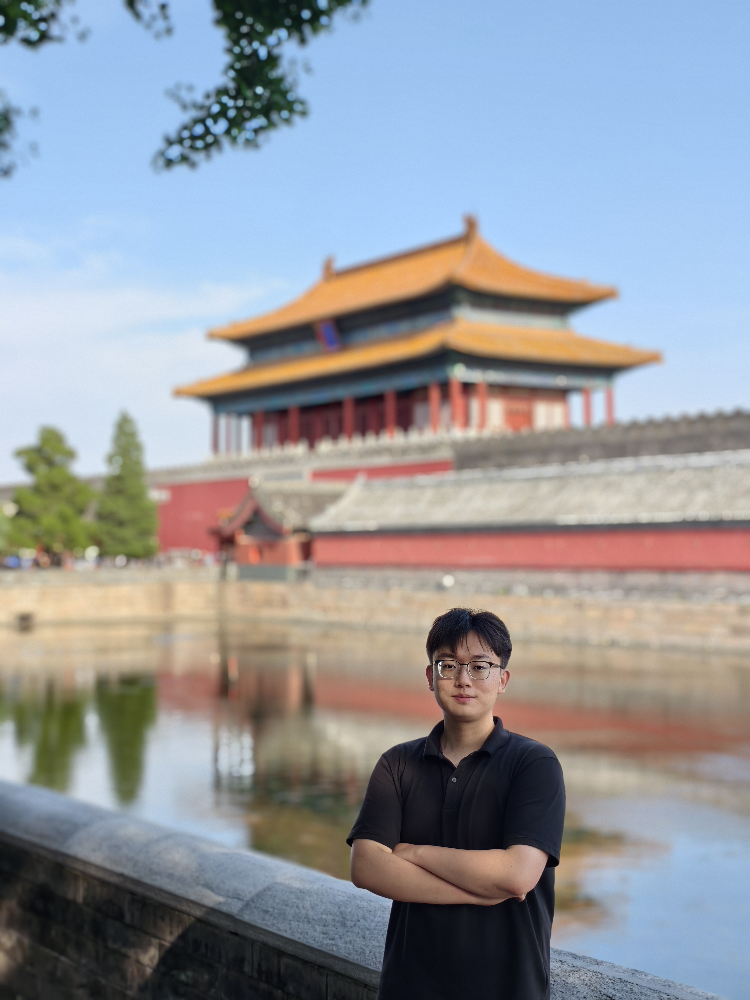

# Zhan Gao · 高展

基于开源学术主页主题 [Minimal Light](https://github.com/yaoyao-liu/minimal-light) 的个人主页，使用项目官方提供的静态 HTML 版本，默认英文。

- 上游版本：`1ea07f39518ac44644406380c83da6f89037c4fc`
- 模板来源：`html_source_file/index.html`
- 样式来源：`html_source_file/assets/css/style-no-dark-mode.css`
- 许可：CC0 1.0 Universal，完整文本见 `LICENSE`

保留原主题的两栏布局、蓝色标题、衬线字体和移动端适配。替换了示例个人信息、论文、荣誉和联系资料；未提供的论文与学术服务不显示。已使用用户提供的本人照片，页面通过 CSS 圆形取景，原图保存在 `avatar.jpg`。没有使用原作者照片或示例简历。为避免外部字体加载影响访问，Google Fonts 导入替换为系统衬线字体。无需 JavaScript、Jekyll 或安装依赖。

## 个人资料

- 姓名：Zhan Gao（高展）
- 身份：山东大学软件学院人工智能博士一年级在读
- 本科：山东大学软件学院
- 研究方向：Intelligent Networks；Networked Embodied Intelligence
- 荣誉：山东大学荣誉学士学位；比亚迪奖学金（前 1%）
- 邮箱：gaozhan@mail.sdu.edu.cn

导师：Prof. Lu Bai；团队：Pervasive Connectivity and Networked Intelligence (PCNI)，链接使用用户提供的地址。未编造入学年份、毕业年份或论文信息。荣誉学位英文暂译为 Honors Bachelor's Degree；若证书有官方英文名称，应以证书为准。

## 编辑

直接修改 `index.html` 中对应的段落和列表。头像样式位于页面顶部，论文位置已用注释标出。

更换头像时，替换 `avatar.jpg`；圆形取景样式在 `index.html` 的 `<style>` 中，可按新照片调整。当前头像结构为：

```html
<span class="image avatar"></span>
```

照片可以只保留文件名，其他文件均使用相对路径，因此网站也能部署在项目子路径。

## GitHub Pages

个人主页地址 `https://USERNAME.github.io/` 要求账号或组织名为 `USERNAME`，仓库名为 `USERNAME.github.io`。仅将当前账号下的仓库改名为 `zhangao.github.io`，无法获得 `https://zhangao.github.io/`。

GitHub 用户名已改为 `zhangao-sdu`，主页目标地址为 https://zhangao-sdu.github.io/ ，仓库为 https://github.com/zhangao-sdu/zhangao-sdu.github.io 。

把本目录文件上传到目标仓库根目录。在仓库 **Settings → Pages** 中选择 **Deploy from a branch → main → / (root)**，保存后等待部署成功。

`.nojekyll` 用于直接托管静态文件。不要设置 `CNAME` 为另一个账号的 `github.io` 地址；GitHub Pages 不支持用这种方式取得该账号的子域名。

## 本地预览

双击 `index.html`，或在本目录运行：

```sh
python3 -m http.server 8000 --bind 127.0.0.1
```

访问 `http://127.0.0.1:8000/`。
